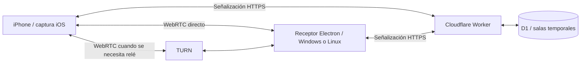

# Arquitectura

## Flujo de conexión

1. El receptor Electron inicia un servidor HTTP local y carga únicamente su interfaz desde loopback.
2. En modo Internet, el proceso principal transmite las peticiones de señalización al Worker HTTPS. El iPhone introduce el código de la sala creada por el receptor.
3. Ambos extremos intercambian SDP y candidatos ICE. El vídeo y el audio viajan por WebRTC directamente o mediante TURN según la red; no pasan por D1.
4. En modo Wi-Fi local, el iPhone utiliza la IP y el puerto que muestra el receptor. Al cerrar la app se libera su servidor.

## Módulos

| Directorio o archivo | Responsabilidad |
| --- | --- |
| `desktop/main.cjs` | Ventana, ciclo de vida y aislamiento de Electron |
| `desktop/runtime.cjs` | Puertos y detección del servidor |
| `desktop/cloud-bridge.cjs` | Proxy de señalización y almacenamiento seguro heredado |
| `desktop/server/` | API local y recursos de interfaz |
| `desktop/server/public/receiver.js` | Conexión WebRTC, vídeo y métricas |
| `desktop/server/public/audio-player.js` | Decodificación y única ruta audible Web Audio |
| `ios/MirrorPhone/` | Captura, normalización, codificación y adaptación de calidad |
| `cloudflare/` | Salas, autenticación de sesión, límites y entrega de ICE |
| `experimental/control-wifi/` | Diagnóstico de servicios de desarrollo; no control global habilitado |

## Decisiones que se deben preservar

- El renderizador tiene sandbox, aislamiento de contexto y Node desactivado. No se desactiva el sandbox de Chromium para resolver instalaciones.
- El audio utiliza un elemento auxiliar silenciado para activar la decodificación; la salida audible procede de un único contexto Web Audio a 48 kHz.
- La negociación H.264 comprueba las capacidades del decodificador antes de modificar su nivel. No modifica audio ni códecs de reparación.
- Resolución y FPS son máximos, no garantías. La adaptación reduce carga y compresión excesiva cuando la red no permite mantener la calidad solicitada.
- Linux no persiste credenciales mediante el backend `basic_text`. El flujo por código no requiere una clave del propietario.

## Datos

D1 mantiene el estado temporal de salas y señalización. Los medios no se graban. Las credenciales TURN son temporales y las claves del proveedor permanecen en el servidor. Los registros de confianza del kit experimental permanecen en el perfil local del usuario y no deben exportarse al repositorio.
